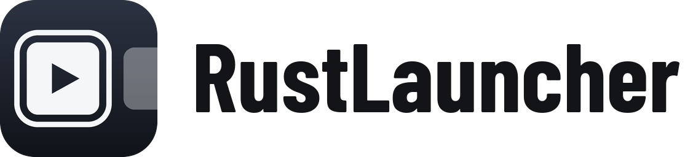

<picture>
  <source media="(prefers-color-scheme: dark)" srcset="docs/rustlauncher-logo-claro.png">
  
</picture>

Launcher alternativo para Roblox, escrito en Rust, con una interfaz de consola
(inspirada en Xbox, PlayStation y Steam Big Picture) y pensado para abrir rápido.

Funciona en **Windows** (con el cliente oficial de Roblox) y en **Linux**
(a través de [Sober](https://sober.vinegarhq.org/)).

> **Aviso:** RustLauncher no está afiliado ni respaldado por Roblox Corporation.
> No modifica el cliente de Roblox: lo descarga de los servidores oficiales y lo
> abre tal cual. Usa APIs web de Roblox que no están documentadas oficialmente y
> pueden cambiar sin aviso.

## Descargar

Descarga el ejecutable de tu sistema desde la
[última versión](https://github.com/ElGtcraft9/Roblox-rust-Launcher/releases/latest):

- **Windows:** `RustLauncher-windows.exe`. Como aún no está firmado con un
  certificado de Windows, SmartScreen avisará de «editor desconocido»: pulsa
  *Más información → Ejecutar de todas formas*.
- **Linux:** `RustLauncher-linux`. Dale permiso de ejecución
  (`chmod +x RustLauncher-linux`). Necesita [Sober](https://sober.vinegarhq.org/).

## Actualizaciones automáticas

Al abrirse (y cada 6 horas) el launcher consulta la última release de este
repositorio. Si hay una versión nueva, la descarga, **comprueba su firma** y se
reemplaza; la nueva versión se usa al reiniciar (*Reiniciar ahora*). Se puede
desactivar en *Ajustes → Launcher*.

Cada ejecutable de una release va acompañado de su firma `minisign`
(`.minisig`). El launcher solo se actualiza si la firma es válida para la clave
pública del proyecto y si nombra esa misma versión y plataforma. La clave
privada no está en el repositorio. Para comprobar una descarga a mano:

```sh
minisign -Vm RustLauncher-linux -P RWT4XCk0ZhR7fDVZ0FmaixOKiHwyUAdqzRWcrm5+Pd9lGtyogm84s1UT
```

## Qué hace

- **Abre los juegos directamente.** En Windows se salta el lanzador oficial
  (que comprueba la versión por internet en cada partida) y mantiene Roblox
  actualizado en segundo plano, así *Jugar* nunca espera a una descarga.
- **Dos modos de interfaz:**
  - **PC:** ventana adaptable, rueda del ratón y flechas.
  - **Consola:** pantalla completa, texto grande, mando y teclado en pantalla.
    Al conectar un mando, el launcher pregunta si quieres cambiar a este modo.
- **Inicio:** el arte del juego enfocado ocupa la pantalla; estantes con
  *Seguir jugando*, *Favoritos* y las listas de Roblox.
- **Buscar** experiencias, con ficha de cada juego.
- **Mercado:** catálogo por categorías y búsqueda (la compra se hace en roblox.com).
- **Social:** buscar personas, enviar solicitudes de amistad y chatear.
- **Perfil:** tu avatar, tu descripción y tus amigos con su estado.
- **Avatar:** ponerte tus trajes y las prendas de tu inventario, y cambiar entre R15 y R6.
- **Ajustes del cliente:** solo los de la
  [lista oficial de Roblox](https://devforum.roblox.com/t/allowlist-for-local-client-configuration-via-fast-flags/3966569)
  (motor gráfico, suavizado, texturas, hierba, detalle lejano…).
- **Barra de carga real:** avanza según lo que el cliente escribe en su registro.
- **Vuelta al launcher:** al salir de una experiencia, cierra Roblox y vuelve el launcher.

## Velocidad

Medido en Linux (Ryzen 7 5700U, NVMe):

| | Tiempo |
|---|---|
| Ventana abierta | ~60 ms |
| Iconos de la portada con caché | listos en ~70 ms |
| 100 iconos sin caché | ~1,0–1,3 s |
| Coste de dibujar un fotograma | ~0,3 ms |

Cómo se consigue:

- miniaturas en WebP (de 5 a 9 veces menos datos que PNG),
- respuestas comprimidas,
- la red empieza a trabajar antes de que exista la ventana,
- caché en disco con decodificación en paralelo,
- precarga de los archivos del cliente con prioridad de disco baja.

Para medirlo en tu equipo: `RUST_LAUNCHER_PERFIL=5 ./rust-launcher`.

## Inicio de sesión y privacidad

El inicio de sesión usa el mecanismo oficial de **Quick Login** de Roblox:
el launcher muestra un código (y un QR) que apruebas desde otro dispositivo con tu
sesión. **El launcher nunca ve tu contraseña.**

La sesión resultante se guarda en el almacén de credenciales del sistema
(Credential Manager en Windows, Secret Service en Linux), nunca en un archivo
propio. Esa sesión da acceso completo a la cuenta: ciérrala desde *Ajustes →
Cuenta* si dejas de usar el launcher.

## Estado

Versión **0.3.0**, en desarrollo.

| Parte | Estado |
|---|---|
| Interfaz, búsqueda, mercado, caché de imágenes | Probado en Linux |
| Abrir juegos con Sober (Linux) | Probado |
| Inicio de sesión: creación del código y QR | Probado |
| **Windows** (abrir juegos, enlaces de roblox.com, actualizaciones) | **Sin probar** |
| Paso final del inicio de sesión, editar el avatar, chat, solicitudes de amistad | **Sin probar con una cuenta real** |
| Mando de juego | **Sin probar con un mando real** |

## Compilar

Necesitas Rust 1.88 o posterior (edición 2024).

```sh
# Linux
cargo build --release

# Windows, compilando desde Linux (necesita mingw-w64)
rustup target add x86_64-pc-windows-gnu
cargo build --release --target x86_64-pc-windows-gnu
```

Pruebas: `cargo test`. Las que usan la red de Roblox están marcadas como
ignoradas y se ejecutan con `cargo test -- --ignored`.

En Linux hace falta tener Sober instalado:
`flatpak install flathub org.vinegarhq.Sober`.

## Publicar una versión

1. Sube la versión en `Cargo.toml` y haz commit.
2. Ejecuta `herramientas/publicar.sh [notas.md]`.

El script compila Windows y Linux, firma ambos ejecutables con la clave privada
(`~/.config/rustlauncher-firma/minisign.key` o `$RUSTLAUNCHER_CLAVE`), genera
`SHA256SUMS` y crea la release con `gh`.

## Estructura

| Archivo | Contenido |
|---|---|
| `src/app/mod.rs` | Estado de la interfaz, arranque y bucle de dibujo |
| `src/app/inicio.rs`, `buscar.rs`, `mercado.rs`, `social.rs`, `perfil.rs`, `avatar.rs`, `ajustes.rs` | Una pantalla cada uno |
| `src/app/capas.rs` | Lanzamiento, inicio de sesión, diálogos y animación del modo consola |
| `src/app/modos.rs` | Modos PC y consola, transiciones y precarga de pestañas |
| `src/app/tareas.rs` | Trabajo en segundo plano, sesión y mensajes |
| `src/app/barras.rs`, `campos.rs`, `dibujo.rs` | Barras, campos de texto y utilidades de dibujo |
| `src/tema.rs` | Colores, tipografía y piezas visuales (ver `DESIGN.md`) |
| `src/api.rs` | APIs web públicas de Roblox (juegos, búsqueda, mercado, miniaturas) |
| `src/sesion.rs` | Inicio de sesión con código, avatar, amigos y chat |
| `src/roblox.rs` | Descarga, verificación e instalación del cliente de Windows |
| `src/windows.rs`, `src/linux.rs` | Lanzamiento del cliente en cada plataforma |
| `src/vigia.rs` | Lectura del registro del cliente (barra de carga y salida del juego) |
| `src/imagenes.rs` | Carga de miniaturas con caché en disco |
| `src/acelerar.rs` | Precarga de archivos y DNS |
| `src/actualizar.rs` | Actualizaciones automáticas firmadas |
| `src/teclado.rs` | Teclado en pantalla del modo consola |
| `src/mando.rs` | Mando de juego |
| `src/flags.rs` | Ajustes del cliente (fast flags permitidas) |
| `herramientas/logo.py` | Genera el logo y los iconos |
| `herramientas/publicar.sh` | Compila, firma y publica una versión |
| `herramientas/minisign.pub` | Clave pública de firma |

## Créditos

Creado por **Gtcraft9355** (en YouTube) con la ayuda de Claude.

- Tipografía [Barlow](https://github.com/jpt/barlow), de Jeremy Tribby, bajo
  licencia SIL Open Font License (ver `assets/OFL-Barlow.txt`).
- Interfaz hecha con [egui](https://github.com/emilk/egui).

## Licencia

[MIT](LICENSE). Las fuentes Barlow mantienen su propia licencia (SIL Open Font License).
